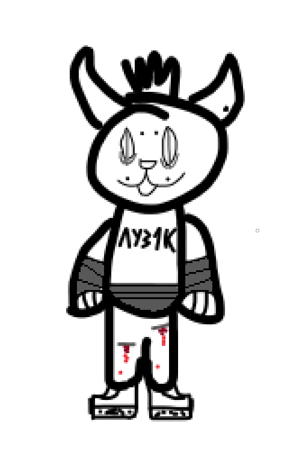

# Luz1k (Sketch Pet)

**A pixel sketch pet living on top of Telegram.**

Tap it, pet it, throw it, shake the phone — or see how long it takes to light up a vape.

 

Luz1k is an on-screen pet for ExteraGram, built from an 18×28 pixel matrix in a
rough sketch style. It walks around the screen, stands on chat bubbles, reacts
to shakes, chat events, and music — and slowly loses it when left alone.

## Controls

| Gesture | Result |
|:--|:--|
| Tap | Poke: it hops and answers with a phrase. |
| Double tap | Joyful jump. |
| Hold and move | Pet it — floating hearts included. |
| Drag | Move it around the screen. |
| Flick | Throw it — it tumbles across the screen. |
| Shake the phone | It flings around with bounce physics (accelerometer). |
| Flick it upward | It hangs off the status bar by its hands. |

## Behavior

- **Gravity** — falls down, slides when the phone is tilted, stands on message
  bubbles and the message input field, and rides along with them.
- **Wanders on its own** — walks, waves, hides behind a screen edge to peek.
- **Sleeps on a noose** — after a configurable timeout (1/3/10 minutes) it
  hangs from a rope and sways. Tap it to wake it up.

## AFK mode

After 45 seconds of being ignored, Luz1k picks one of three loops on its own:

- 🚬 **vapes** — a tank-style pod (Aegis Boost / XROS vibes) held to its mouth,
  LED glow on the puff, vapor drifting across the screen;
- 🍺 **drinks Zhiguli beer** — tilts the bottle for a gulp, then lowers it
  half-empty with a drop on its lip;
- 🔪 **cuts its veins** — blade to the wrist, a cut, and blood running down.

## The shotgun

Drag Luz1k onto the message input field in a chat and it pulls a Ronnie act:
presses the barrel to its head, fires, splatters into gory chunks on the floor,
then reassembles itself in the center of the screen. Fully rendered in phases:
aim → muzzle flash → remains → rebuild.

## Telegram reactions

- Incoming messages and your own sends (with a special reaction for essays).
- Keywords: «привет», «люблю», «ахаха» — each with its own animation.
- Opened chats: comments on familiar and new ones.
- Music: dances to tracks, listens to voice messages.

## Brain

Luz1k remembers you: your name, attachment level (from acquaintance to best
friend), days spent together, habits, favorite chats and tracks, and recent
events. It writes down new facts on its own. Memory is stored locally on the
phone and can be wiped from the settings.

## AI replies (optional)

Phrases can be generated by a neural network: Google Gemini or any
OpenAI-compatible API (OpenRouter, Groq, a local server). A backup provider is
supported, message text is only shared behind a separate switch, and the AI can
pick animations and decide where the pet walks.

## Privacy

- The brain is a single JSON file inside the app's private storage.
- Message text is sent to the AI provider **only** if you explicitly enable
  «Видит текст сообщений».
- With AI disabled there are no network requests at all.

## Settings

Show or hide the pet, pick a size (small/medium/large) and a palette (original
sketch, dark inversion, acid punk), toggle gravity, wandering, phrases,
haptics, shake detection, Telegram events, and music reactions, set the sleep
timeout, configure the brain (name, about, self-learning, sharing, forget
everything), and set up the AI provider, key, model, URL, and chat frequency.

## Compatibility

- ExteraGram **12.10.6** or later.
- Plugin SDK **1.4.5.7** or later.
- SDK files for `armeabi-v7a` and `arm64-v8a` are included.

## Project files

| File | Purpose |
|:--|:--|
| `losiq.plugin` | Plugin source and metadata. |
| `image.png` | Original character sketch. |
| `plugins-sdk/` | Plugin SDK libraries for the supported ABIs. |
