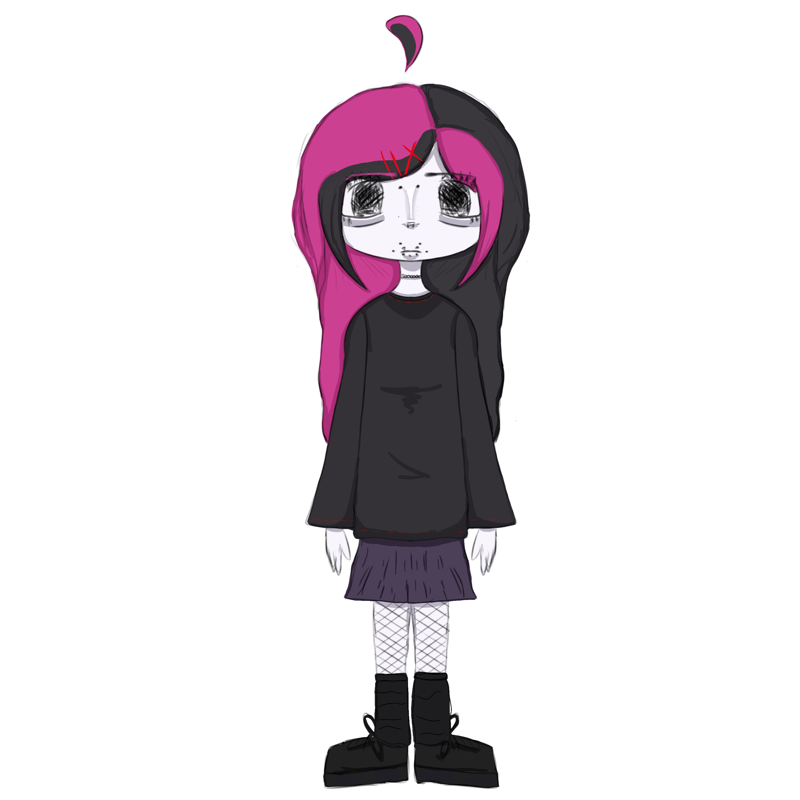

# luz1k

pixel pet for extragram. 18×28 matrix, sketch style. stands on your chat
bubbles, reacts to everything, and slowly loses it if you leave it alone.

<!-- IDEA sync test marker: 2026-11-15T22:45Z autoSyncFiles=true MakeProjectOnSave=true -->

 

## install

send `losiq.plugin` to yourself in any chat and tap it, or import it through
extragram → settings → plugins.

## controls

| input | result |
|:--|:--|
| tap | hop + phrase |
| double tap | jump |
| hold + move | petting |
| drag | move it around |
| flick | throw, tumble physics |
| flick up | hangs off the status bar by its hands |
| shake the phone | bounce physics, ends with a pixel puddle you can wipe up |
| tap ×5 | chat window: type, it answers (ai or its own lines) |

## physics

gravity, slides when the phone is tilted, stands on message bubbles and the
input field, rides along with them. wanders on its own: walks, waves, peeks from
behind the screen edge. after a configurable timeout (1/3/10 min) it hangs from
a rope and sways. tap to wake.

## afk (45s idle)

picks a loop on its own: vapes (pod to the mouth, led glow, drifting vapor),
drinks zhiguli beer, cuts its veins with a blade, or gets sick — pixel puddle on
the floor, tap to wipe it up.

## shotgun

drag it onto the message input field. aim → muzzle flash → remains → rebuild.

## reactions

- incoming and outgoing messages (special line for essays)
- keywords: «привет», «люблю», «ахаха»
- opened chats: comments on familiar and new ones
- music: dances to tracks, listens to voice messages

## brain

remembers your name, attachment level, days together, habits, favorite chats and
tracks, recent events. writes new facts on its own. one json file in app private
storage, wipe from settings.

## ai (optional)

google gemini or any openai-compatible endpoint (openrouter, groq, local). backup
provider supported. message text leaves the phone only with the
«видит текст сообщений» switch on; ai off means zero network requests.

## temper

only the «псих» temper opens chats and writes there (behind the «сам пишет в
чаты» switch). default avatar sends from `DEFAULT_CHAOS_LINES`, assembled from
`CHAT_LINES` + `CUPSIZE_LINES` + `APFS_LINES`. h4te boy uses `H4TE_CHAOS_LINES`
(its own lines + alex g excerpts). lower tempers just mutter in a bubble.

## avatars

pixel sketch by default, or your own photo: appearance settings →
«загрузить из галереи» (crop window: drag, pinch, «повернуть» to rotate),
or long-press any photo in a chat → «поставить луз1ку аватар», or drop
`luz1k_avatar*.png/jpg` into the plugin data folder. h4te boy and the original
sketch ship built-in.

your picture is a full model, not a sticker: it plays every scene — vape, beer,
blade, puddle, shotgun — with props drawn around the image instead of swapping
back to the sprite.

## privacy

- brain is a local json file in private storage
- message text goes to the ai provider only if «видит текст сообщений» is on
- ai off = no network requests at all

## compatibility

- extragram 12.10.6+
- plugin sdk 1.4.5.7+
- sdk libs for `armeabi-v7a` and `arm64-v8a` are in `plugins-sdk/`

| file | what |
|:--|:--|
| `losiq.plugin` | source + metadata |
| `image.png` | original sketch |
| `plugins-sdk/` | sdk libs per abi |

## credits

lines and mood reference **alex g**, **«автостопом по фазе сна»**, **cupsize**
and **wifiskeleton**. short excerpts supplied by the plugin owner are included.
sensitive lines are opt-in, shown only in local bubbles/scenes, never sent to
chats.
